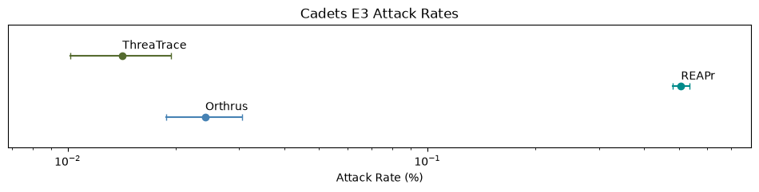
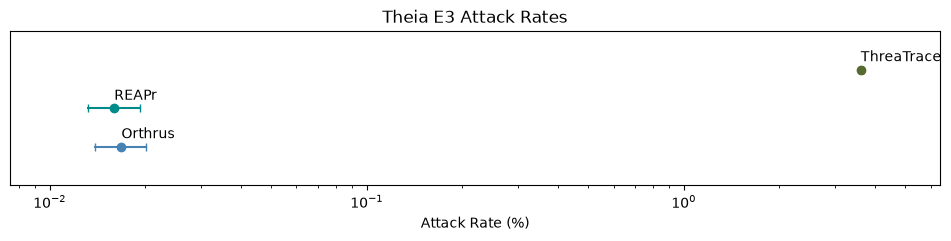
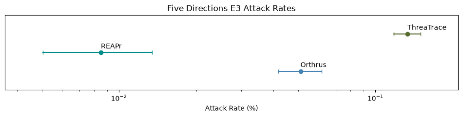
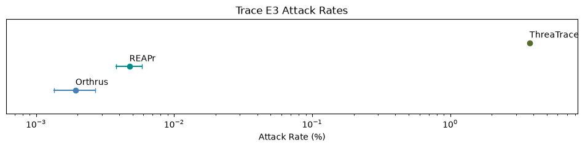

# Exploration of Intrusion Detection Dataset Labelling Methodologies - Results and Analysis
This repository contains results and analysis files developed as part of a technology project unit at Swinburne University. The results data has been collected through experiments conducted as a collaborative group effort, and the analysis has been completed individually.

## Project Background
An intrusion detection system (IDS) monitors security audit logs to detect potentially malicious activity within a computer system or network. Because sample audit logs are essential for testing the effectiveness of newly developed IDSs, open source intrusion detection datasets, such as the DARPA Transparent Computing datasets, have been created for this purpose. However, the creators of these datasets often do not provide granular labels indicating which log entries should be classed as malicious or benign activity. Because of this, IDS developers must often assign the dataset labels themselves when testing their systems, which has resulted in the emergence of a range of different labelling approaches and methods, as well as multiple competing ground truths for individual datasets.

With this context, this project explores different methodologies used to apply ground truth labelling to intrusion detection datasets, and how these affect evaluation of graph neural network (GNN)-based IDS performance. 

## Implementation
Project experiments were performed using the open source platform [PIDSMaker](https://github.com/ubc-provenance/PIDSMaker) to evaluate different IDSs, datasets and ground truth sources.

## Dataset Attack Rates

**Key Insight:** ThreaTrace ground truth consistently overreports malicious activity  

## Intrusion Detection System Performance

**Key Insight:** Comparative model performance tends to be consistent across different ground truths, despite variation in individual performance metric values.

### Receiver Operating Characteristic (ROC) Area Under Curve (AUC)

### Precision

### Recall

## Running the Analysis Scripts
`data_analysis.py` analyses the data in the first sheet of `Datasets.xlsx` and writes the analysis results to for each dataset to the sheet with the same name within the same `Datasets.xlsx` file. `performance_analysis.py` analyses the data in `ModelPerformance.xlsx` and saves the results to `PerformanceAnalysis.xlsx`. The corresponding plots generated by both scripts are saved in the `/Plots` directory.

### Dependencies

Both scripts can be run in a Python environment with the Pandas, Scipy and Matplotlib libraries installed.

